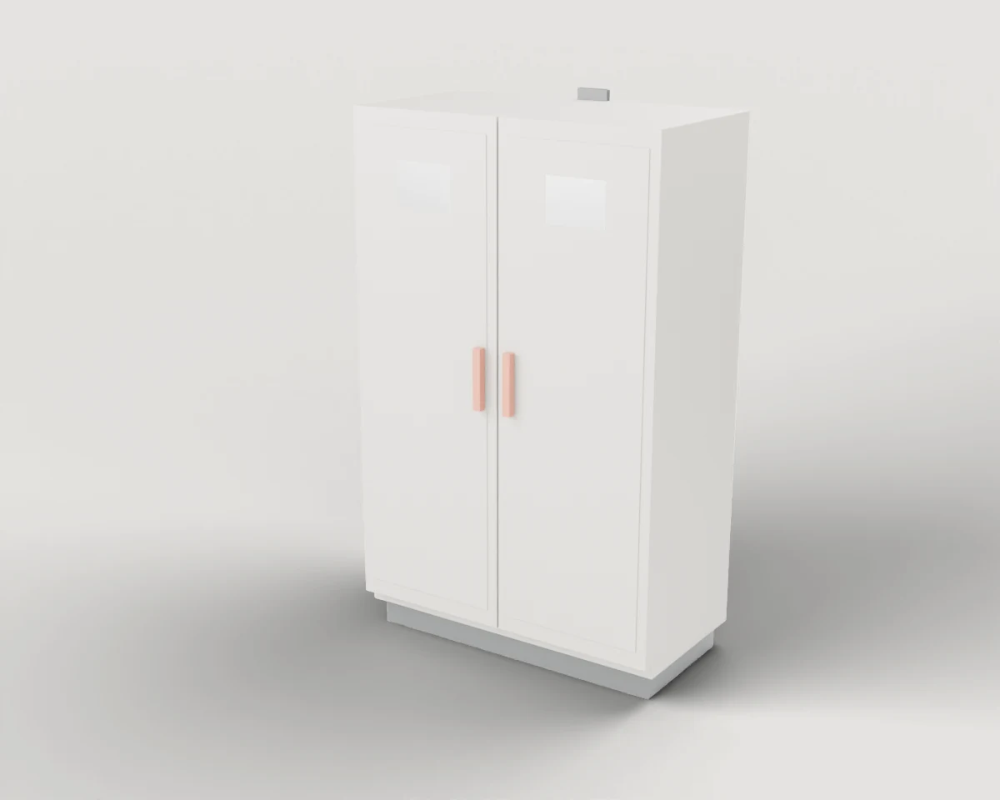
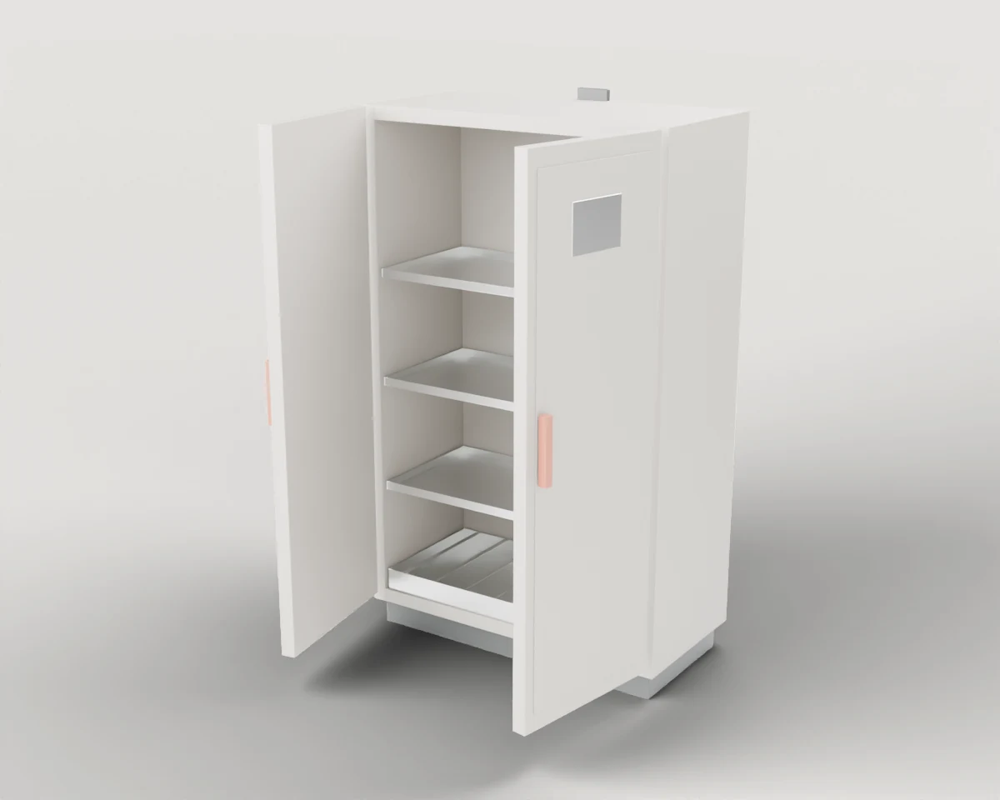
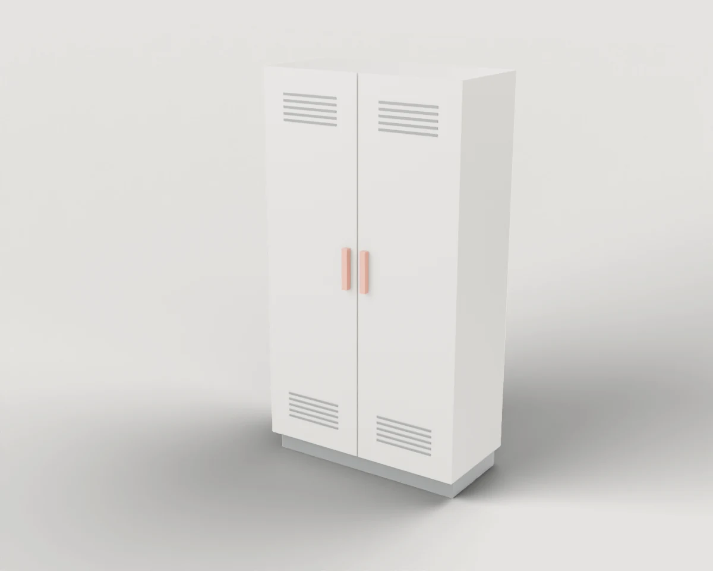
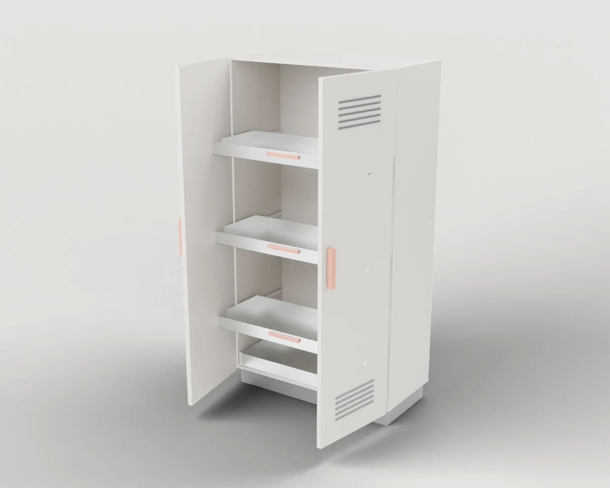
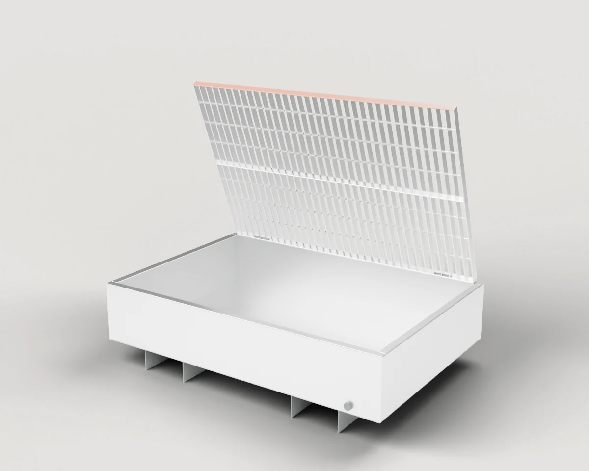
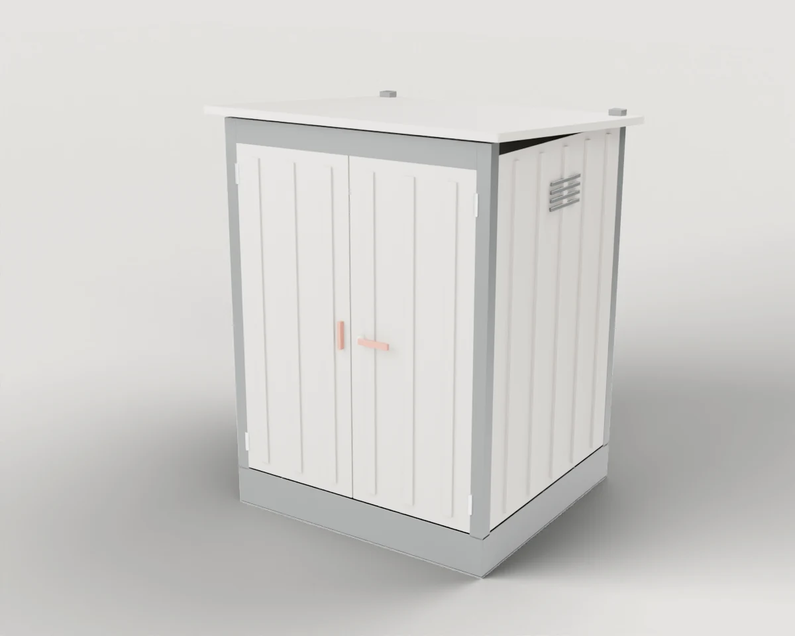
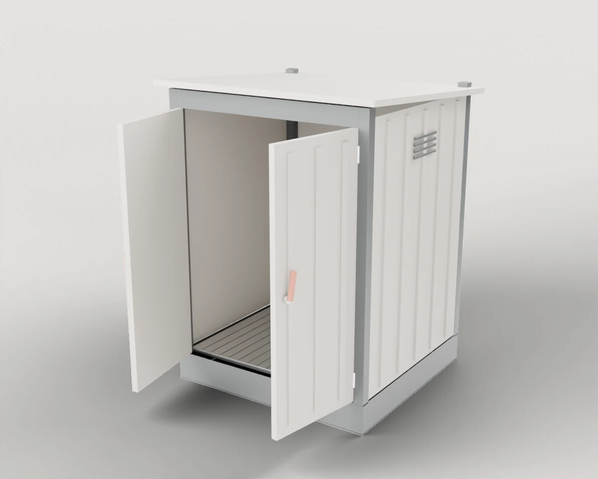

# Hazardous Materials Storage

Safety and chemical cabinets, sump pallets and depots for flammable or polluting substances.

4 objects. Each folder holds `model.blend`, `model.urdf`, `assets/*.glb`, the model's `README.md` and `NOTICE.md`, and two renders (`renders/rest.webp` closed, `renders/open.webp` with the moving parts open).

| Closed | Open | Object | Size W × D × H (cm) | Moving joints | Interaction frames |
| --- | --- | --- | --- | --- | --- |
|  |  | **[#147 Fire-Resistant Safety Cabinet](./147-fire_safety_cabinet/)** Insulated two-door cabinet for flammable liquids with three shelf trays and a bottom sump. | 119 × 66 × 199 | 2× hinges | 7 |
|  |  | **[#148 Chemical Cabinet with Pull-out Trays](./148-chemical_storage_cabinet/)** Sheet-steel cabinet for aggressive or polluting liquids: two hinged doors over three pull-out sump trays and a fixed floor sump. Variant of [#147](./147-fire_safety_cabinet/). | 105 × 54 × 195 | 3× slides, 2× hinges | 10 |
|  |  | **[#149 Drum Sump Pallet with Hinged Grating](./149-drum_sump_pallet/)** Steel sump pallet for two drums with fork pockets underneath; the grating hinges up at the back to empty the sump. | 124 × 85 × 37 | 1× hinges | 3 |
|  |  | **[#150 Hazardous Materials Depot](./150-hazmat_depot/)** Outdoor steel depot with an integrated floor sump under a grating and two wing doors, the right one locked by a swing handle. | 164 × 154 × 212 | 3× hinges | 6 |

[← All categories](../)
