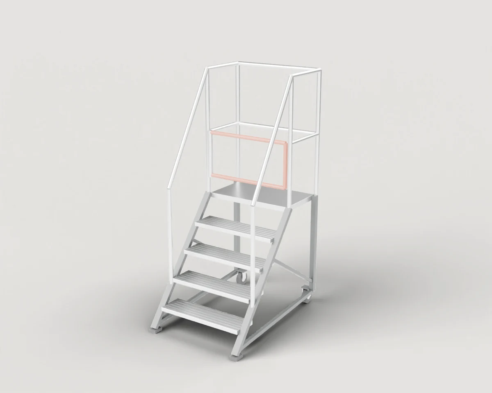
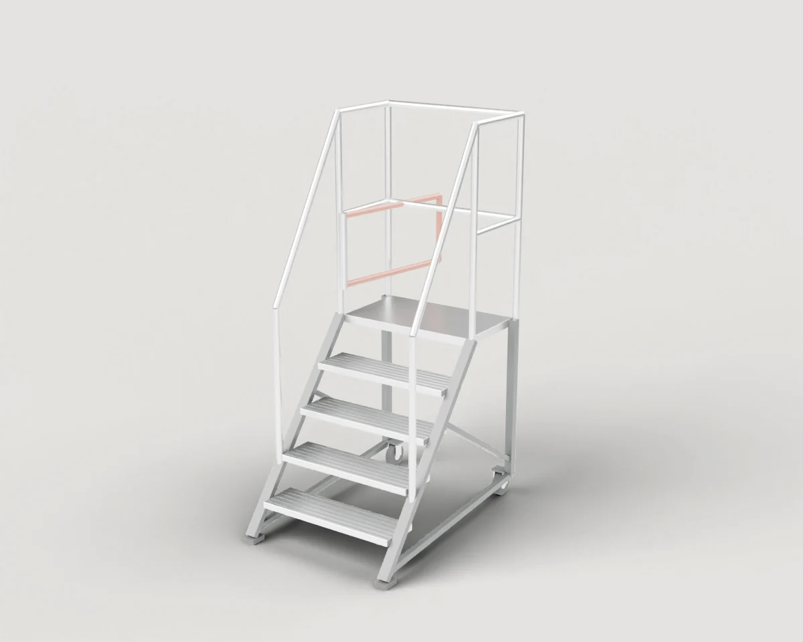

# Ladders & Steps

Mobile platform steps for reaching upper shelf levels safely.

1 objects. Each folder holds `model.blend`, `model.urdf`, `assets/*.glb`, the model's `README.md` and `NOTICE.md`, and two renders (`renders/rest.webp` closed, `renders/open.webp` with the moving parts open).

| Closed | Open | Object | Size W × D × H (cm) | Moving joints | Interaction frames |
| --- | --- | --- | --- | --- | --- |
|  |  | **[#146 Mobile Platform Steps](./146-mobile_platform_steps/)** Four-step steel platform steps with handrails, a self-closing gate at the top and two rear castors for moving it. | 82 × 121 × 197 | 1× hinges, 2× spins/rolls | 5 |

[← All categories](../)
