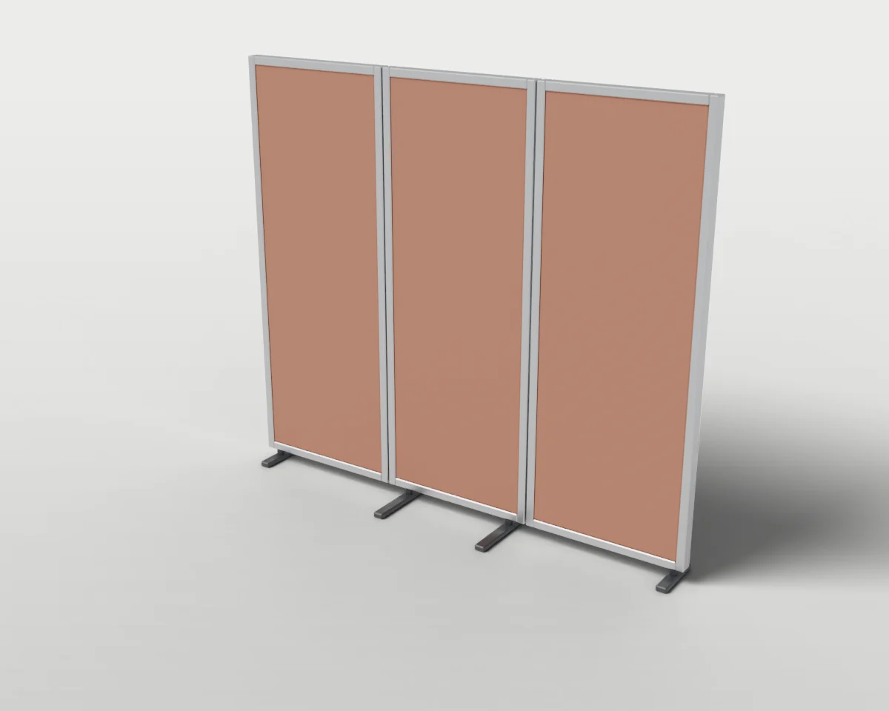
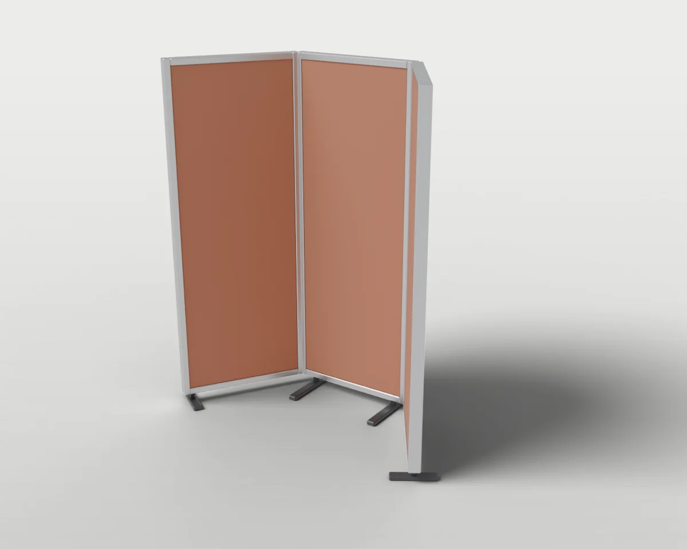

# Room Dividers

Folding screens and partitions that stand free.

1 objects. Each folder holds `model.blend`, `model.urdf`, `assets/*.glb`, the model's `README.md` and `NOTICE.md`, and two renders (`renders/rest.webp` closed, `renders/open.webp` with the moving parts open).

| Closed | Open | Object | Size W × D × H (cm) | Moving joints | Interaction frames |
| --- | --- | --- | --- | --- | --- |
|  |  | **[#020 Folding Partition Screen](./020-folding_partition_screen/)** Three-panel acoustic screen whose outer panels fold on vertical hinges to stand free. | 180 × 40 × 160 | 2× hinges | 4 |

[← All categories](../)
