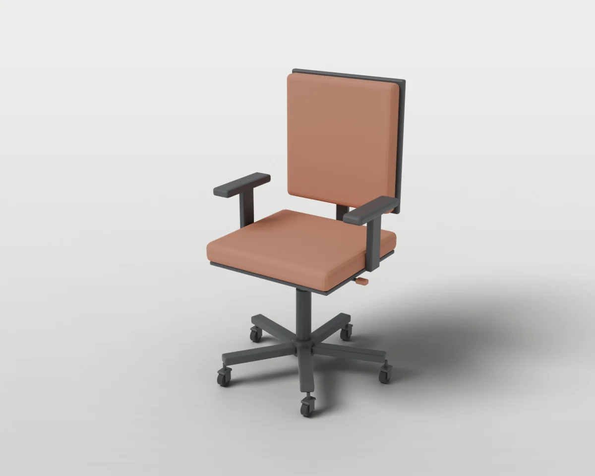
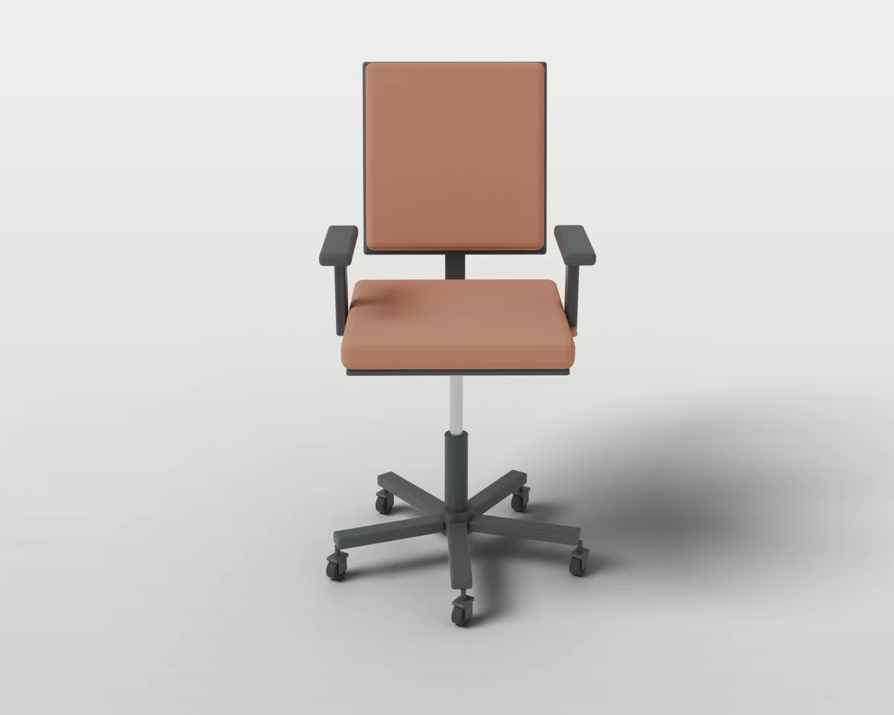
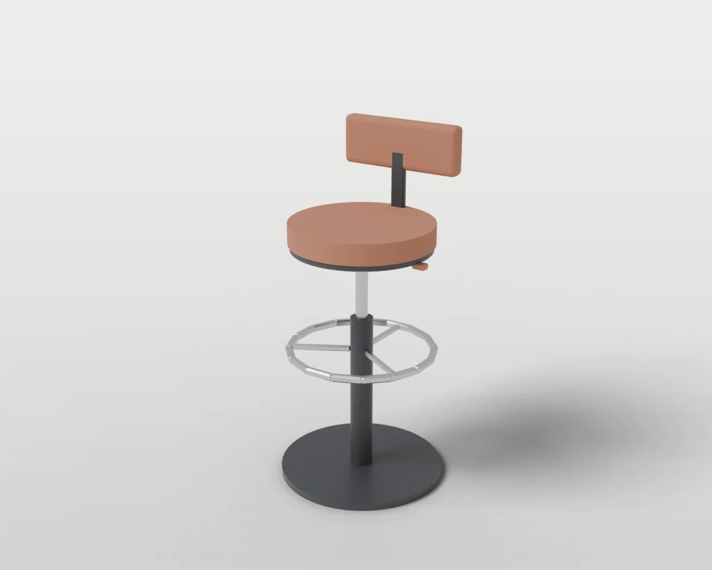
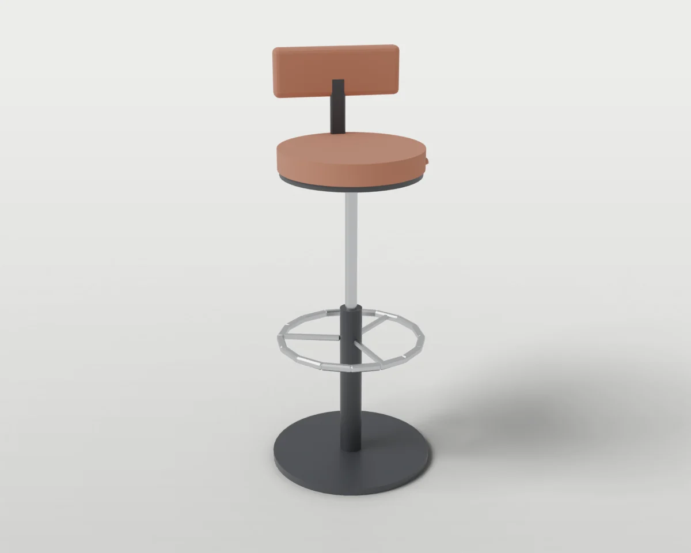
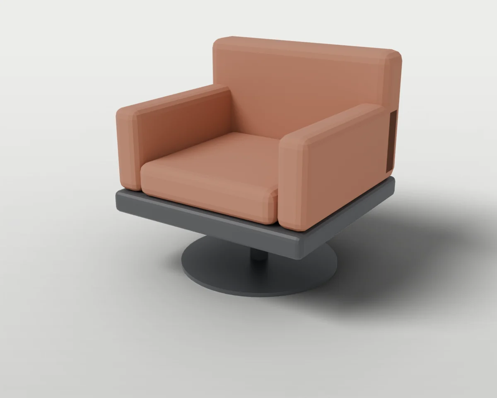
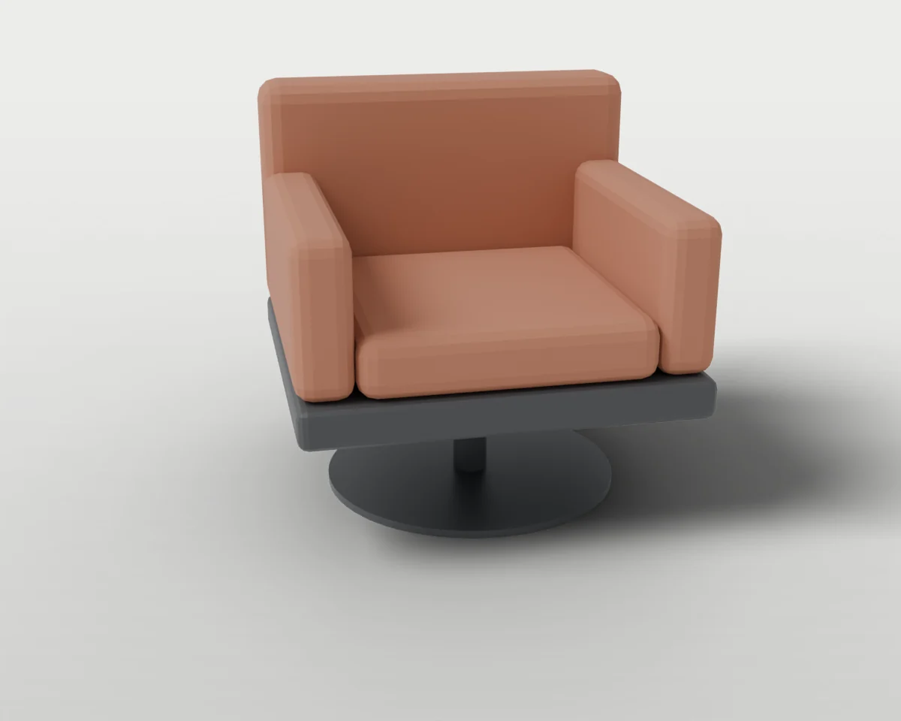

# Seating

Chairs, stools and armchairs with lifts, swivels and reclining backs.

3 objects. Each folder holds `model.blend`, `model.urdf`, `assets/*.glb`, the model's `README.md` and `NOTICE.md`, and two renders (`renders/rest.webp` closed, `renders/open.webp` with the moving parts open).

| Closed | Open | Object | Size W × D × H (cm) | Moving joints | Interaction frames |
| --- | --- | --- | --- | --- | --- |
|  |  | **[#016 Swivel Office Chair](./016-swivel_office_chair/)** Task chair on a five-star base with gas lift, swivel seat, reclining back and height lever. | 66 × 66 × 107 | 6× spins/rolls, 1× slides, 2× hinges | 6 |
|  |  | **[#021 Swivel Bar Stool](./021-swivel_bar_stool/)** Counter-height stool with gas lift, swivel seat, low backrest and a foot ring. | 45 × 45 × 95 | 1× slides, 1× spins/rolls, 1× hinges | 4 |
|  |  | **[#029 Lounge Swivel Armchair](./029-lounge_swivel_armchair/)** Upholstered reception armchair on a disc base that swivels a full turn. | 80 × 78 × 80 | 1× spins/rolls | 4 |

[← All categories](../)
