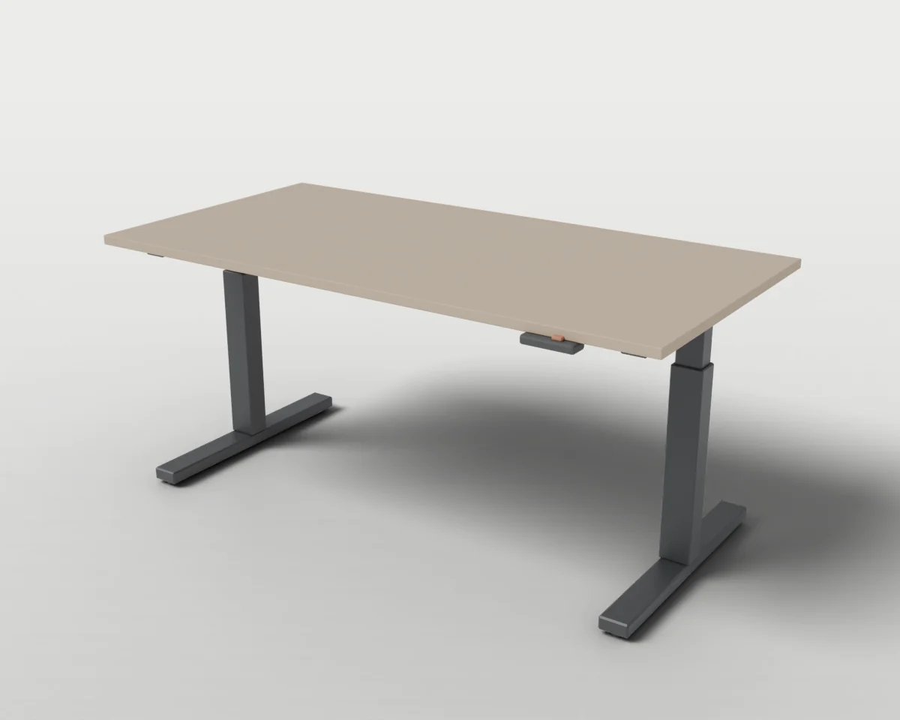
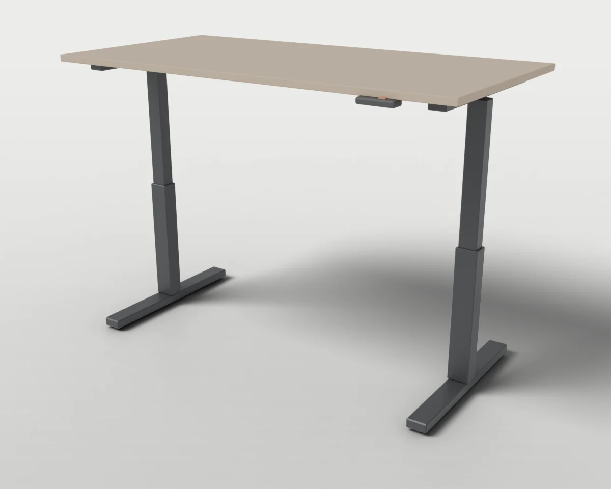
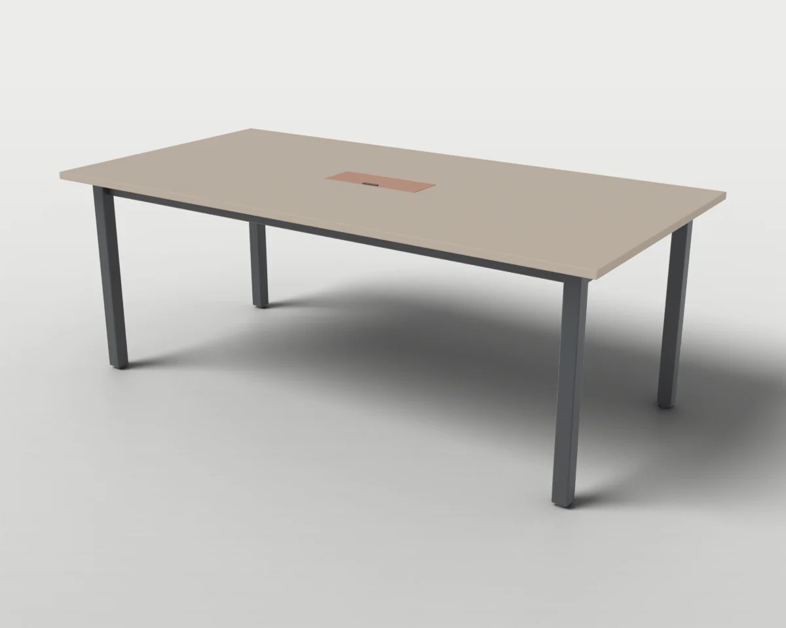
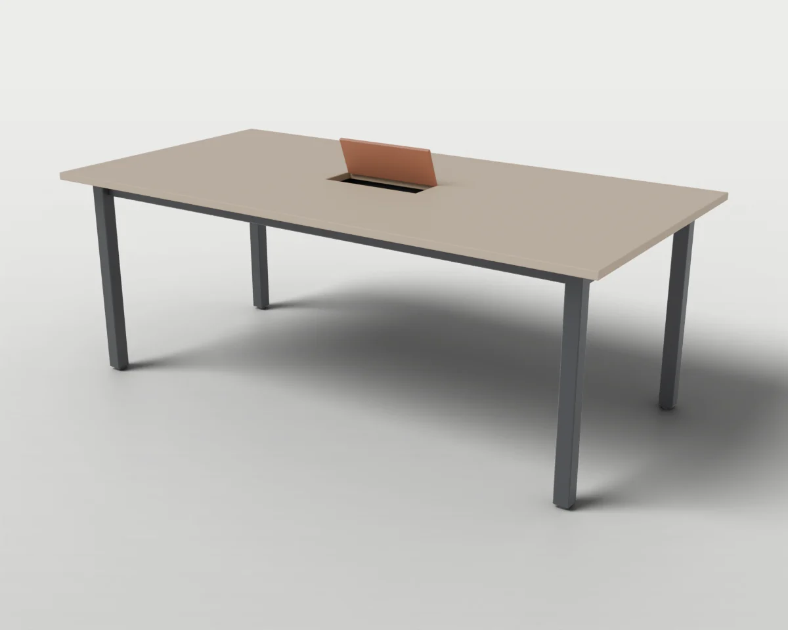
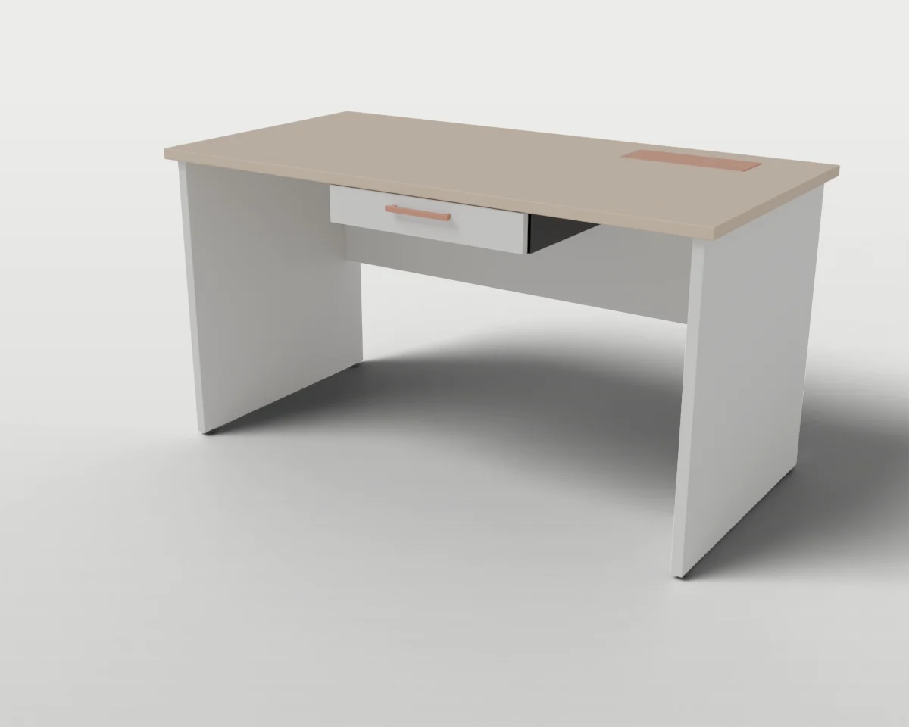
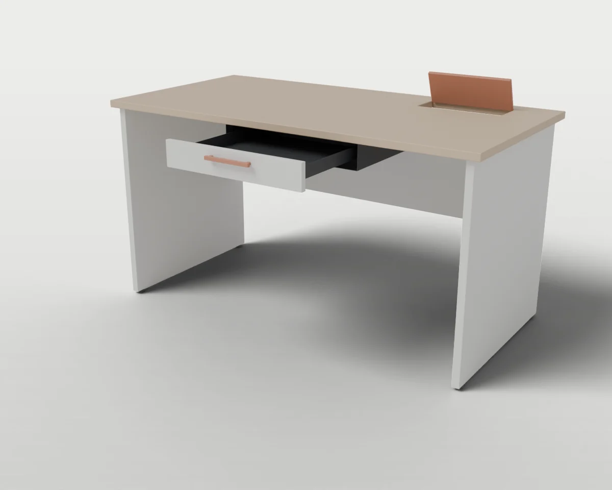
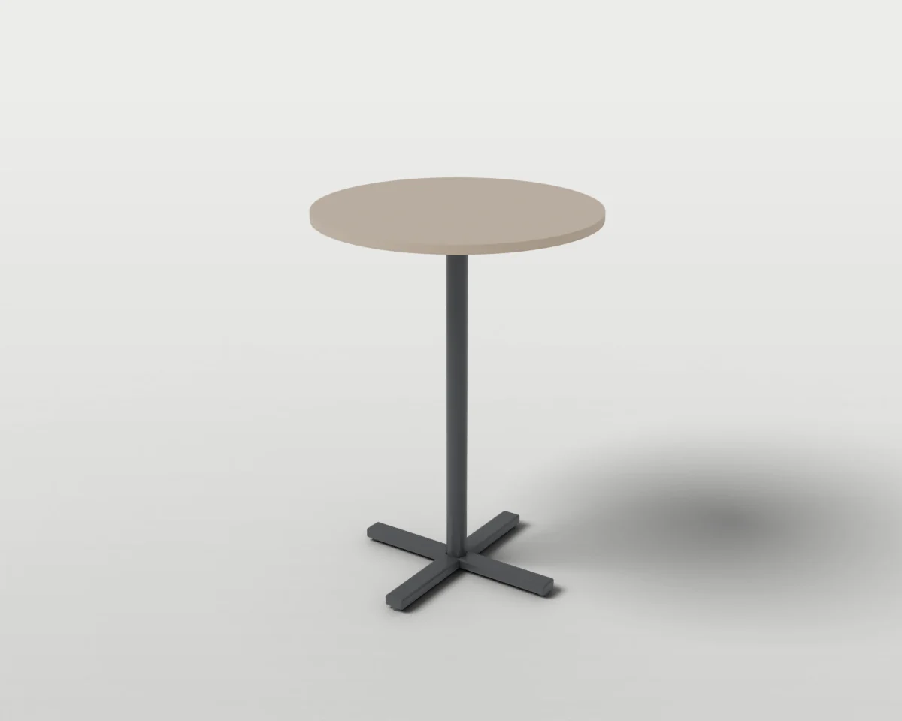
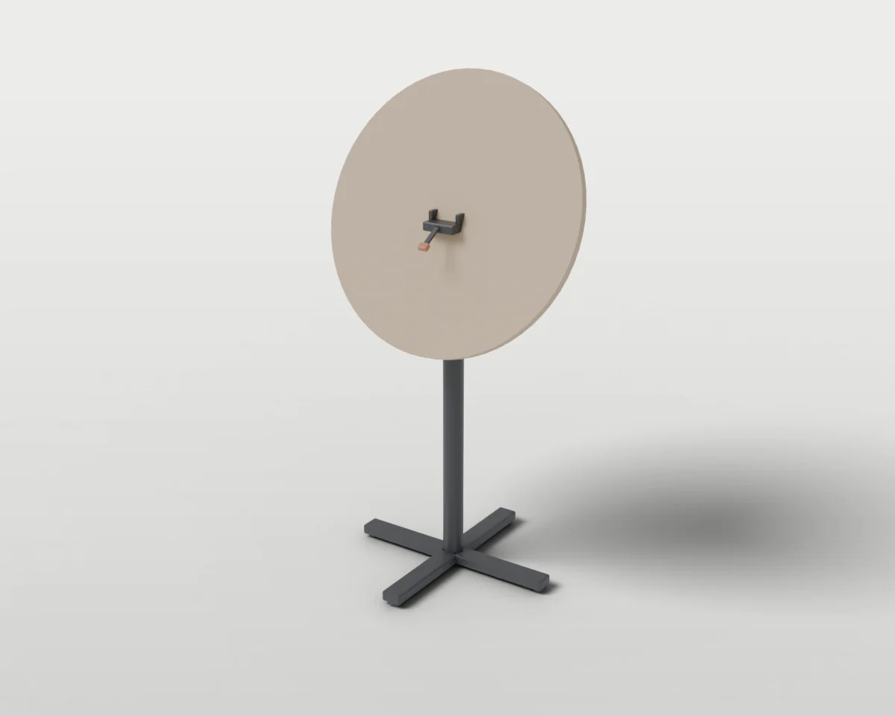
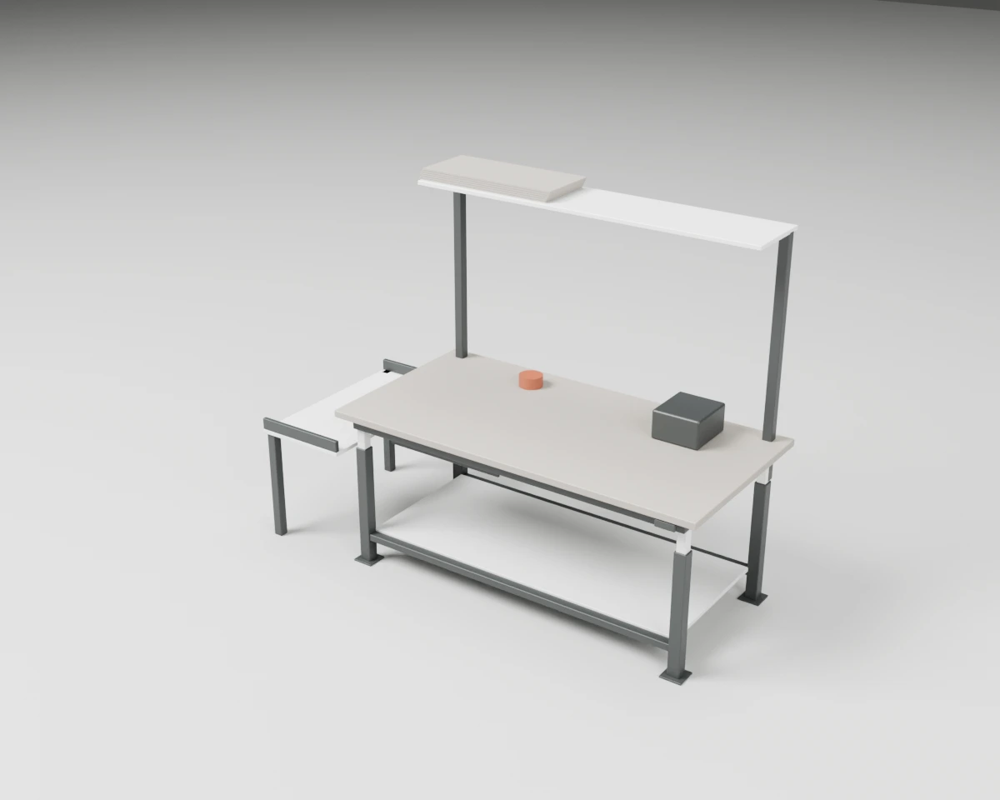
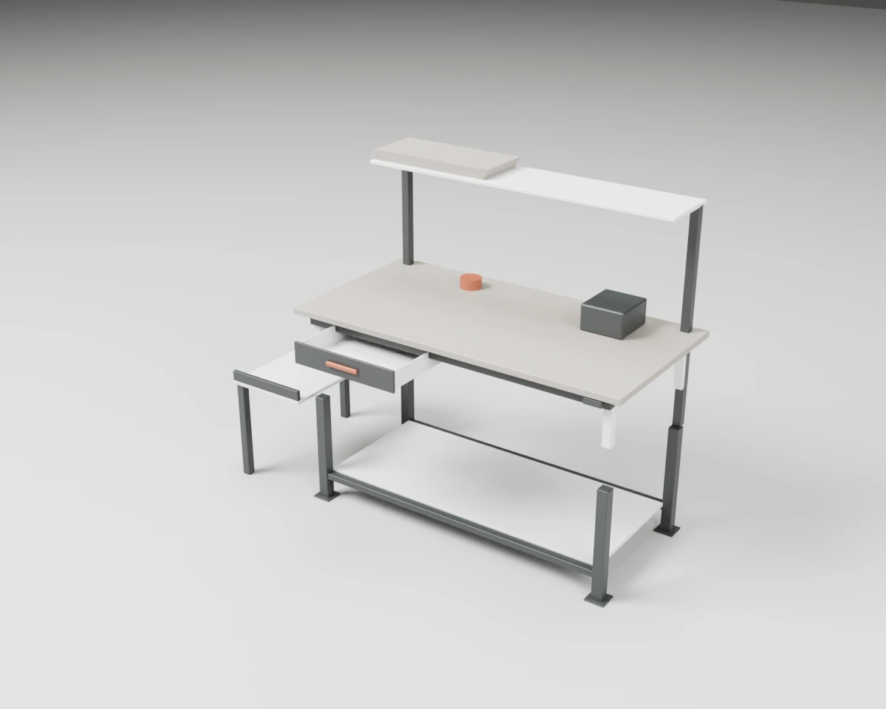

# Tables & Desks

Desks and tables with height adjustment, drawers, cable flaps and tilting tops.

5 objects. Each folder holds `model.blend`, `model.urdf`, `assets/*.glb`, the model's `README.md` and `NOTICE.md`, and two renders (`renders/rest.webp` closed, `renders/open.webp` with the moving parts open).

| Closed | Open | Object | Size W × D × H (cm) | Moving joints | Interaction frames |
| --- | --- | --- | --- | --- | --- |
|  |  | **[#017 Electric Sit-Stand Desk](./017-sit_stand_desk/)** Desk on two telescoping columns with a front control pad for raising and lowering the top. | 160 × 80 × 72 | 2× slides | 3 |
|  |  | **[#019 Conference Table with Cable Well](./019-conference_table/)** Meeting table for six with a hinged cable-well lid and an open cable tray below. | 200 × 100 × 74 | 1× hinges | 4 |
|  |  | **[#026 Desk with Drawer and Cable Flap](./026-desk_with_drawer/)** Panel-leg writing desk with a shallow under-top drawer and a hinged cable flap. Variant of [#017](./017-sit_stand_desk/). | 140 × 70 × 74 | 1× slides, 1× hinges | 5 |
|  |  | **[#028 Tilt-Top Standing Table](./028-tilt_top_standing_table/)** Round standing table on a cross base whose top tilts upright for storage. | 80 × 80 × 110 | 2× hinges | 4 |
|  |  | **[#152 Packing Station with Tote In-feed](./152-packing_station/)** Height-adjustable packing table with a drawer, a carton shelf above and a low in-feed shelf for delivered totes. | 200 × 80 × 157 | 2× slides | 6 |

[← All categories](../)
