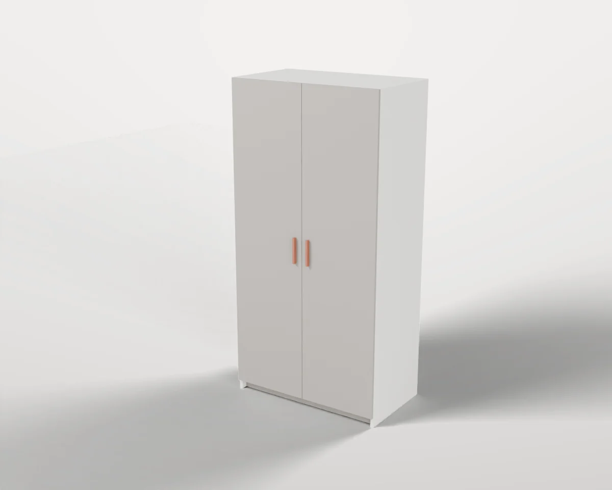
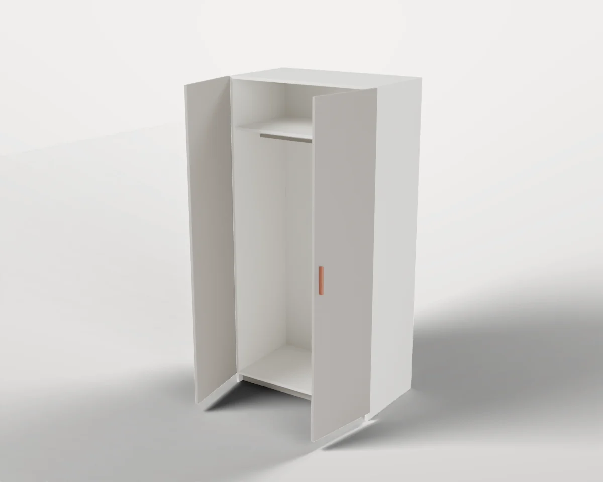
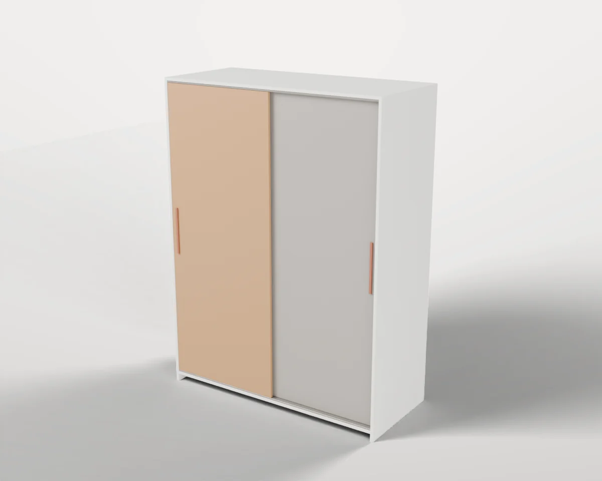
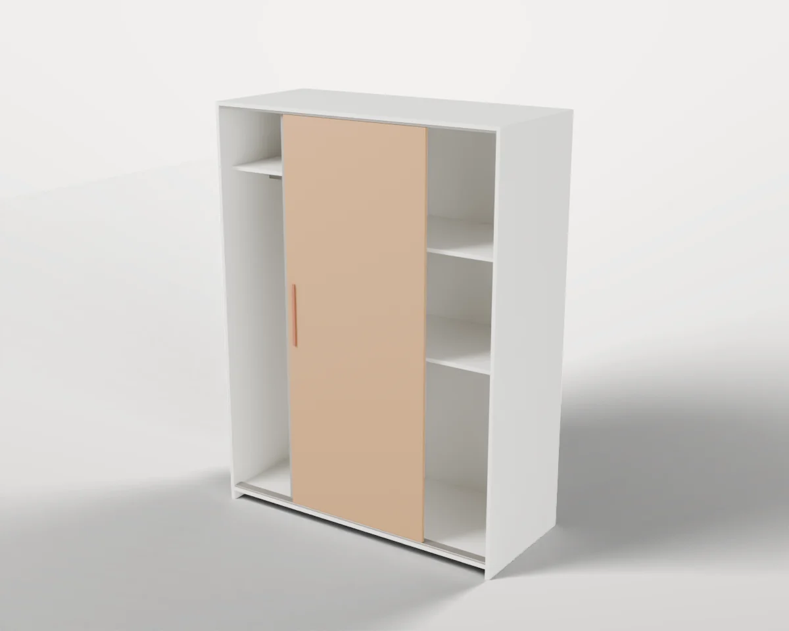
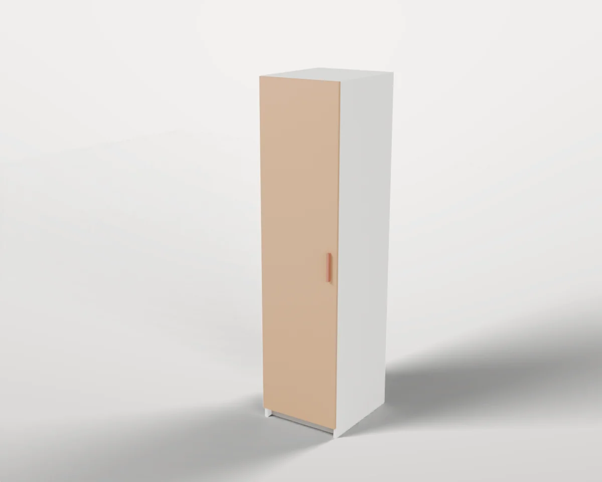
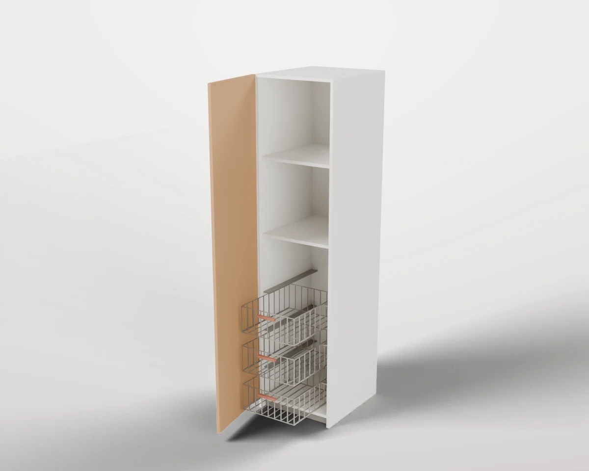

# Wardrobes

Full-height wardrobes with hinged or sliding doors, rails and baskets.

3 objects. Each folder holds `model.blend`, `model.urdf`, `assets/*.glb`, the model's `README.md` and `NOTICE.md`, and two renders (`renders/rest.webp` closed, `renders/open.webp` with the moving parts open).

| Closed | Open | Object | Size W × D × H (cm) | Moving joints | Interaction frames |
| --- | --- | --- | --- | --- | --- |
|  |  | **[#004 Wardrobe Frame with Hinged Doors](./004-wardrobe_frame_hinged_doors/)** Full-height wardrobe frame with two hinged doors, a hat shelf and a hanging rail. | 100 × 58 × 201 | 2× hinges | 4 |
|  |  | **[#005 Sliding-Door Wardrobe](./005-sliding_door_wardrobe/)** Wide wardrobe with two bypass sliding doors over a hanging bay and a shelved bay. Variant of [#004](./004-wardrobe_frame_hinged_doors/). | 150 × 66 × 201 | 2× slides | 6 |
|  |  | **[#006 Wardrobe with Pull-out Wire Baskets](./006-wardrobe_pullout_baskets/)** Narrow wardrobe with one hinged door, three pull-out wire baskets and two shelves. Variant of [#004](./004-wardrobe_frame_hinged_doors/). | 50 × 58 × 201 | 1× hinges, 3× slides | 10 |

[← All categories](../)
