# Containers & Boxes

Lidded and folding crates, mesh pallet boxes, drums and walk-in storage containers.

6 objects. Each folder holds `model.blend`, `model.urdf`, `assets/*.glb`, the model's `README.md` and `NOTICE.md`, and two renders (`renders/rest.webp` closed, `renders/open.webp` with the moving parts open).

| Closed | Open | Object | Size W × D × H (cm) | Moving joints | Interaction frames |
| --- | --- | --- | --- | --- | --- |
| 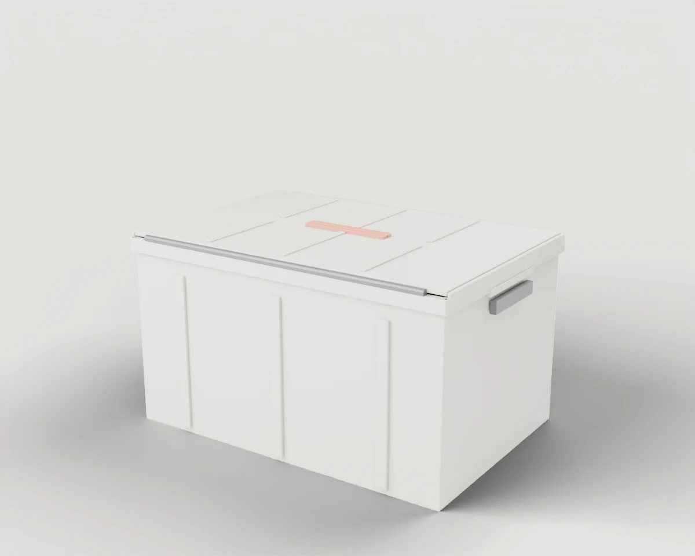 | 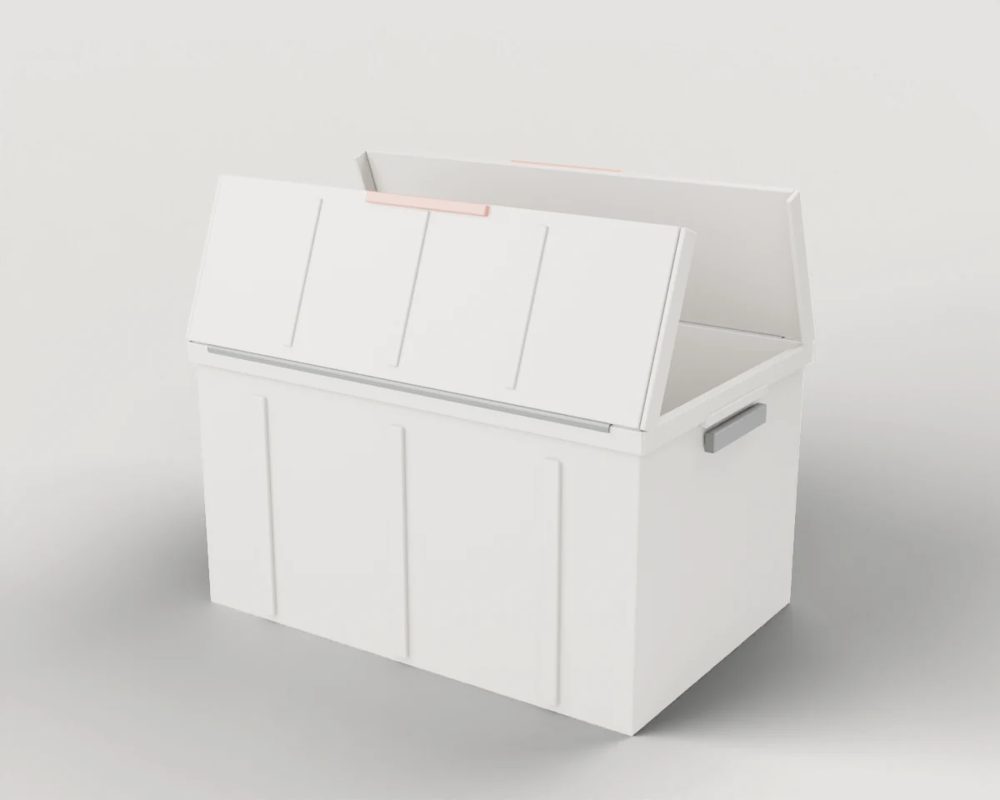 | **[#139 Attached-Lid Container](./139-attached_lid_container/)** Stackable plastic tote whose two lid halves hinge open from the long top edges. | 63 × 42 × 35 | 2× hinges | 5 |
| 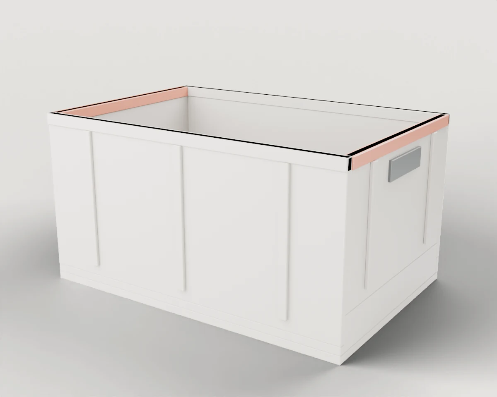 | 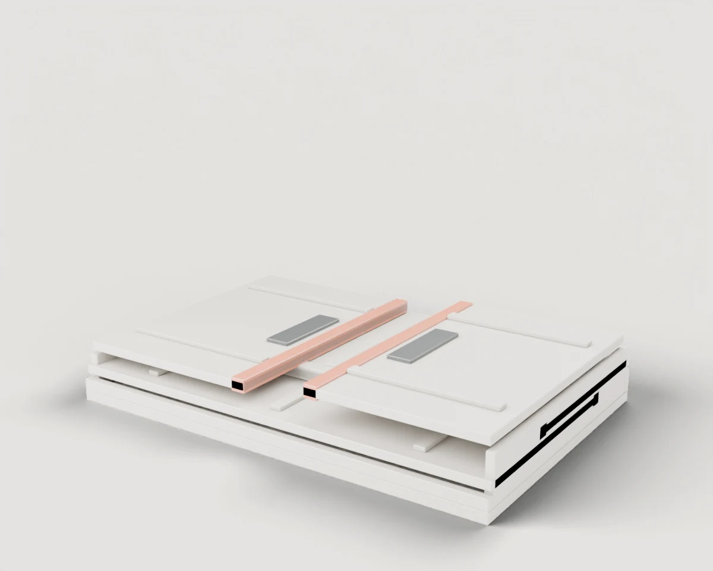 | **[#140 Folding Crate](./140-folding_crate/)** Plastic crate whose four walls hinge at the base and fold flat: long walls first, short walls on top. | 61 × 41 × 32 | 4× hinges | 3 |
| 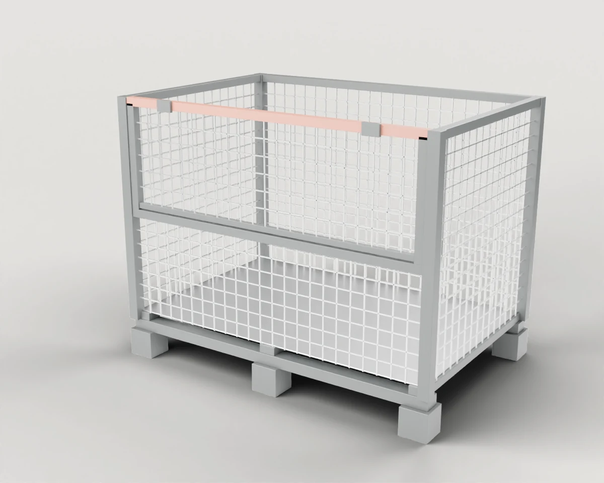 | 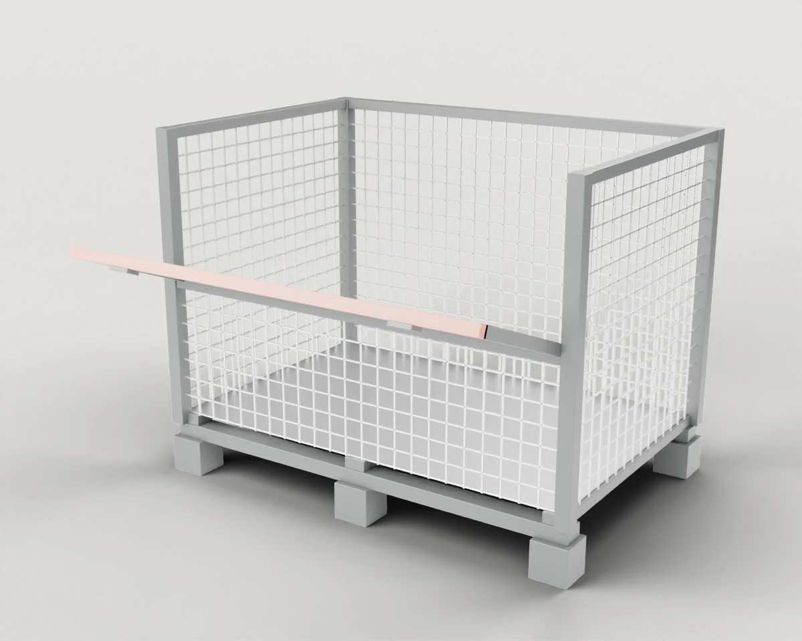 | **[#141 Mesh Pallet Box with Drop-down Flap](./141-mesh_pallet_box/)** Stackable steel mesh box on pallet feet; the upper half of the front wall drops down for access. | 124 × 84 × 98 | 1× hinges | 4 |
| 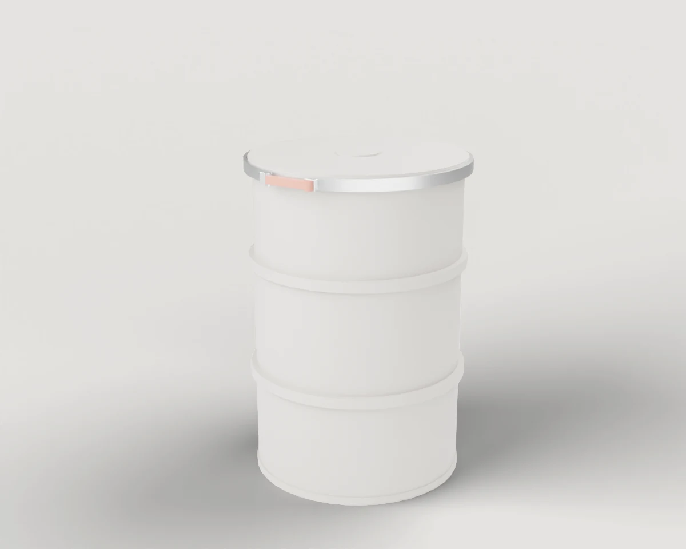 | 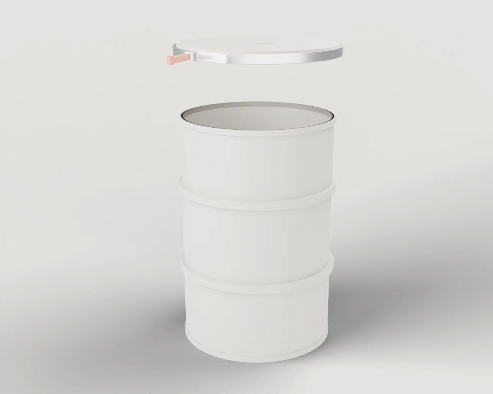 | **[#142 Open-Top Drum with Clamp Ring](./142-open_top_drum/)** Plastic open-top drum with two rolling hoops; a lever closes the clamp ring that holds the lid down. | 63 × 65 × 91 | 1× slides, 1× hinges | 5 |
| 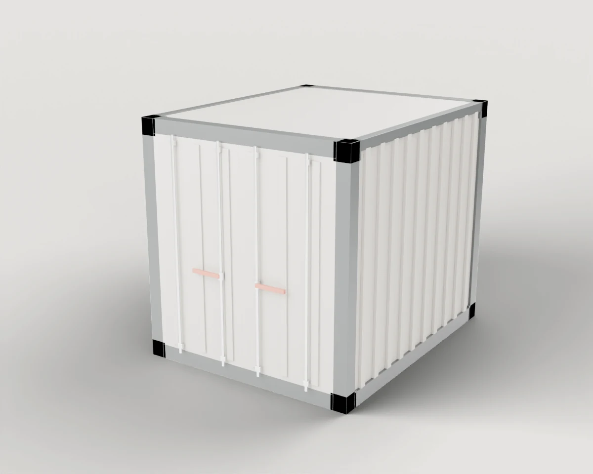 | 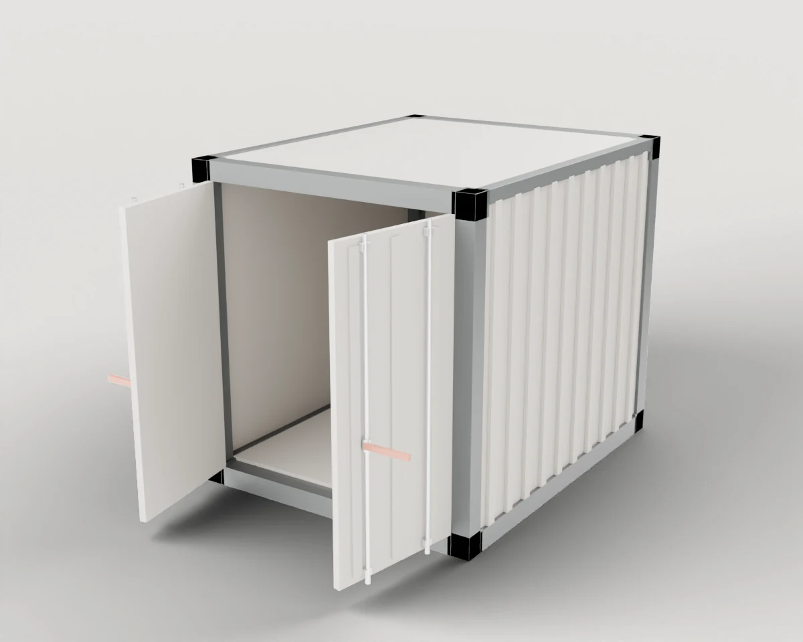 | **[#143 Walk-in Storage Container](./143-storage_container/)** Ten-foot steel storage container with corrugated walls and two end doors, each locked by a swinging bar handle. | 245 × 307 × 259 | 4× hinges | 7 |
| 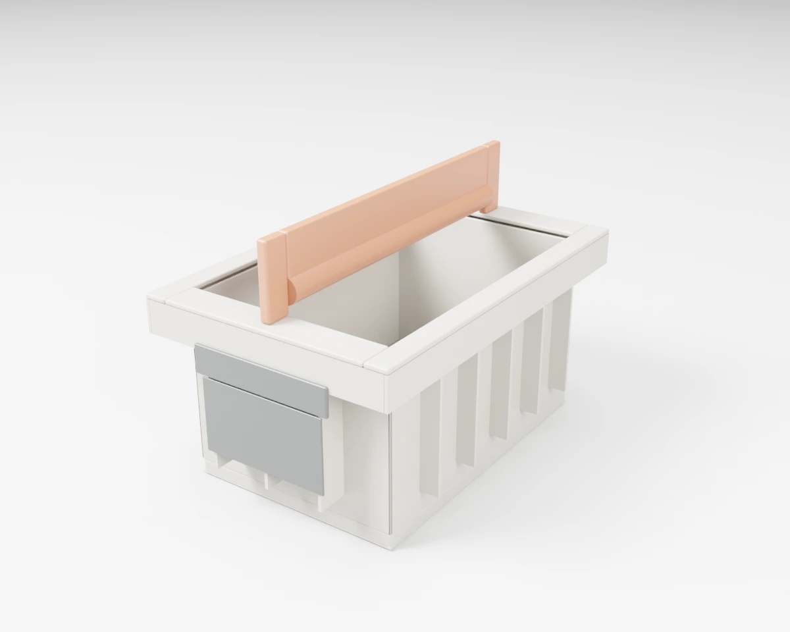 |  | **[#151 Robot Tote with Bulb Rail](./151-robot_tote_bulb_rail/)** Stackable small-load tote with a moulded bulb rail across the top that a parallel gripper holds from above. | 20 × 30 × 20 | none | 2 |

[← All categories](../)
